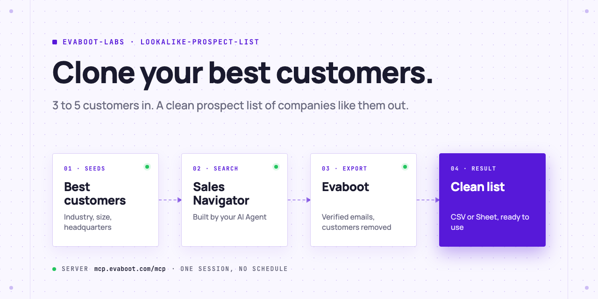
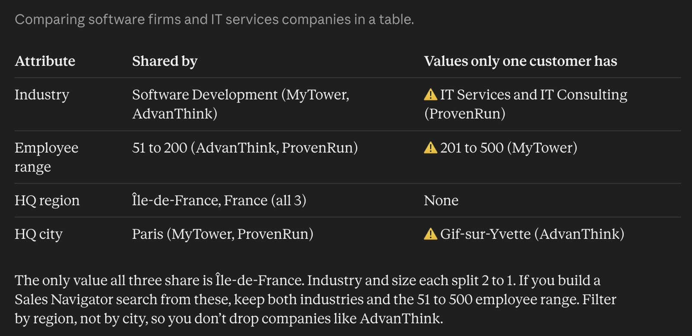
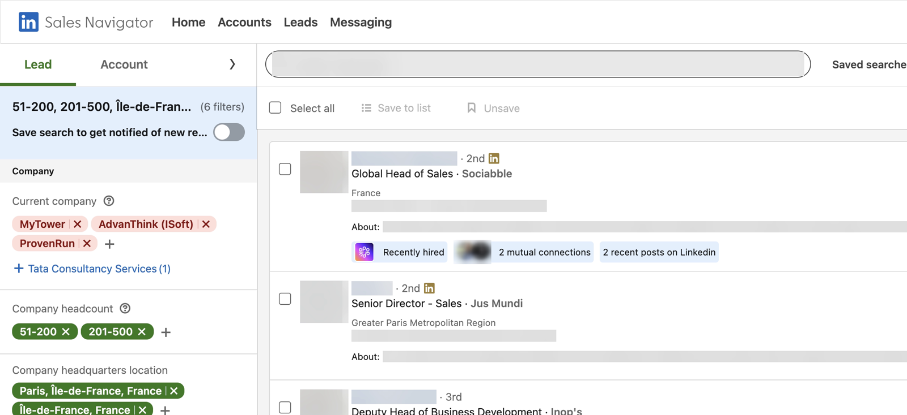
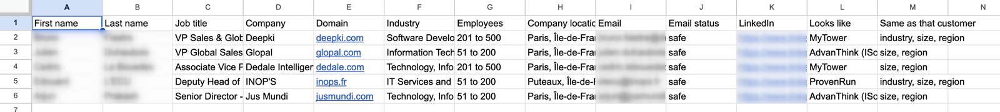

<picture>
  <source media="(prefers-color-scheme: dark)" srcset=".github/assets/banner-dark.png">
  
</picture>

# Lookalike prospect list

Give your AI Agent 3 to 5 of your best customers. It finds what they share (industry, size, headquarters), builds the Sales Navigator search for the people you sell to at companies like them, exports them with verified emails through Evaboot, removes your customers, and hands you a clean CSV or Google Sheet that says which customer each lead looks like. One session, no schedule.

[](AGENTS.md)
[](https://evaboot.com/mcp)
[](LICENSE)

## Set it up in one prompt

Paste this into Claude Code, Codex or Cursor:

```text
Clone https://github.com/evaboot-labs/lookalike-prospect-list, read AGENTS.md and follow the skill. Build me a prospect list of companies like my best customers.
```

<details>
<summary>Or install the skill</summary>

Claude Code:

```text
/plugin marketplace add evaboot-labs/lookalike-prospect-list
/plugin install lookalike-prospect-list@evaboot-labs-lookalike-prospect-list
```

Codex, Cursor and other agents:

```bash
npx skills add evaboot-labs/lookalike-prospect-list
```

</details>

## How it works

**1. Your customers become the filters.** The agent reads the industry, size and headquarters your customers share, and asks before it keeps a value only one of them has.



**2. One Sales Navigator search, your customers excluded.** Evaboot builds the people part from your sentence; the agent adds the industry, size and headquarters filters and removes your customers.



**3. A clean list.** Only leads inside the filters with a safe email, each with the customer it looks like. In our test, 5 of 10 exported leads made the list.



## What you need

- An [Evaboot account](https://dash.evaboot.com/accounts/signup/?last_click_origin=lookalike-prospect-list-repo) and a Sales Navigator seat.
- Python 3 for `lookalike.py`. No packages.
- Cost: 1 Evaboot credit per exported lead, email included. Leads dropped by the clean-up are paid too, so start with 10.

## Go further

| Page | For |
|---|---|
| [SEEDS.md](SEEDS.md) | Your best customers and who you sell to |
| [docs/seeds.md](docs/seeds.md) | Which customers to pick and where each field comes from |
| [docs/connect-your-agent.md](docs/connect-your-agent.md) | The Evaboot MCP server, by hand, for each agent |
| [docs/n8n.md](docs/n8n.md) | The same list built from an n8n form |

---

Agents: start at [AGENTS.md](AGENTS.md) · Built by [Evaboot](https://evaboot.com) · More workflows at [github.com/evaboot-labs](https://github.com/evaboot-labs) · [MIT license](LICENSE)
